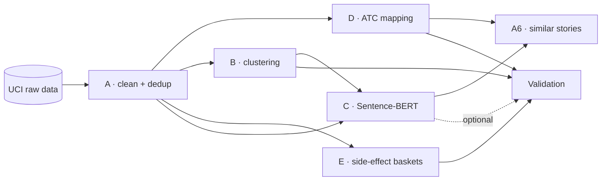

# Patient Experience Mining (UCI Drug Reviews)

Final project for 02807 Computational Tools for Data Science (DTU, autumn 2026), group of 5.

We organise about 36,000 free-text drug reviews into recurring patient experiences, mine which side effects patients report together, and test whether drugs that feel alike to patients also share a pharmacological class.

**Research questions**

1. Can patient reviews be grouped into common experiences (side effects, effectiveness, reasons for stopping)?
2. Which side effects do patients report together, and do those combinations differ between drugs for the same condition?
3. Which drugs do patients experience similarly, regardless of official classification?
4. Does the type of experience a patient reports predict their rating?

## Pipeline

One folder per stage. Each folder has its notebook, a README (method, main results, output files) and an `outputs/` folder with the results.

| Stage | Folder | What it does | Course topic | Answers | Local run |
|---|---|---|---|---|---|
| A | [`data-cleaning-and-lsh`](data-cleaning-and-lsh) | Cleaning; near-duplicate removal with our own **MinHash + LSH**; similar patient stories across drugs (word sets, and Sentence-BERT with random-hyperplane LSH) | Similar items / LSH | data, RQ3 | ~2 min |
| D | [`atc-mapping`](atc-mapping) | ATC class of every drug from RxNorm (cached, runs offline) | | data | ~10 s |
| B | [`clustering`](clustering) | TF-IDF + LSA, **k-means** and **DBSCAN** per condition, our own **Davies-Bouldin** and k-means++ | Clustering | RQ1 | ~15 min |
| E | [`frequent_itemsets`](frequent_itemsets) | Side-effect lexicon and baskets, our own **A-priori** and **PCY**, association rules with significance tests | Frequent itemsets | RQ2 | ~30 s |
| C | [`nlp-embeddings`](nlp-embeddings) | **Sentence-BERT** embeddings (BioLORD-2023), class-based TF-IDF topic terms and keywords for B's clusters | New technique | RQ1 | GPU (Kaggle) |
| V | [`validation`](validation) | Drug experience profiles vs ATC classes (permutation tests, hierarchical clustering of drugs), rating prediction | Clustering (of drugs) | RQ3, RQ4 | ~1.5 min |

Dependencies between the stages (an arrow means "uses the outputs of"):



A's notebook contains both the cleaning (A1-A5) and the similar-story search (A6). A6 uses D's drug names and C's embeddings, so on Kaggle A's notebook is run last, with D's and C's outputs as inputs. Without them, A6 runs the word version only.

## Data

- **Source:** UCI Drug Review Dataset (Drugs.com), 215,063 reviews with drug, condition, 1-10 rating and text. Gräßer et al., *Aspect-Based Sentiment Analysis of Drug Reviews Applying Cross-Domain and Cross-Data Learning*, Digital Health 2018. Download: <https://archive.ics.uci.edu/ml/machine-learning-databases/00462/drugsCom_raw.zip> (43 MB), or the Kaggle mirror `jessicali9530/kuc-hackathon-winter-2018`.
- **Large intermediate files** are not in the repository. They are published on Kaggle:
  - A's clean data (`reviews_clean_deduplicated.parquet`, 66 MB): output of the Kaggle notebook <https://www.kaggle.com/code/diegofogued/clean-and-deduplicate>;
  - C's Sentence-BERT embeddings (395 MB): Kaggle dataset <https://www.kaggle.com/datasets/claudiagranado/dataset-input-versionantiguaresultados>.
- **Results** of every stage are committed in its `outputs/` folder, so each notebook can be read without running anything.

## How to run

**Locally (everything except C, about 5 minutes):**

1. Install the packages: `pip install -r requirements.txt`
2. Download the zip above and unzip `drugsComTrain_raw.tsv` and `drugsComTest_raw.tsv` into `data/raw/` (git-ignored).
3. Run the pipeline: `python run_pipeline.py`

`run_pipeline.py` runs A → D → E → validation and saves each notebook with its outputs. `--with-clustering` also reruns B and `--with-nlp` also reruns C. B and C are not in the default run: C needs a GPU, and C's labels are built on the committed clusters of B (see the docstring of `run_pipeline.py`). Each notebook can also be run on its own with **Restart & Run All**: it reads the other stages' outputs from their folders.

**On Kaggle:** each notebook looks for its inputs under `/kaggle/input`. Add the outputs of the stages it uses (table above) as inputs; the README of each folder gives the exact names.

## Reproducibility (checked 28 Nov 2026)

Every notebook except C was rerun from the raw UCI files on a clean copy of this repository (`python run_pipeline.py --with-clustering`, about 20 minutes on a laptop, no errors):

| Stage | Result of the rerun |
|---|---|
| A | Same 128,663 clean reviews; same A6 numbers (1,711 shared stories, 93 drug pairs, 5 significant). Needs `nltk`. The search by meaning (A6b) needs C's embeddings, so its numbers come from the Kaggle run of 26 Nov. |
| D | Same ATC class for every review. |
| B | Same k in every condition; identical clusters in Birth Control and Acne, 98-99.5 % of the reviews in the same cluster in Depression and Pain. DBSCAN's number of clusters varies between runs. |
| E | Identical numbers; only the benchmark times depend on the machine. |
| Validation | Rerun on the committed B clusters: all 32 tests significant. With B rerun as well, the gaps and AUCs move by at most 0.007 and 0.001. |
| C | Not rerun locally: it needs the embeddings dataset. Its committed outputs were made on B's previous clustering and have to be rerun on Kaggle (see `nlp-embeddings/README.md`). |

## Repository layout

```
data/raw/                 raw UCI files (not committed; see Data)
data-cleaning-and-lsh/    A · clean-data-and-lsh.ipynb
atc-mapping/              D · atc-mapping.ipynb, outputs/ (incl. the RxNav cache)
clustering/               B · clustering.ipynb, outputs/
frequent_itemsets/        E · frequent-itemsets.ipynb, side_effect_lexicon.json, lexicon/, outputs/
nlp-embeddings/           C · nlp-embeddings.ipynb, outputs/
validation/               V · validation.ipynb, outputs/
run_pipeline.py           runs the notebooks in order
requirements.txt
```
